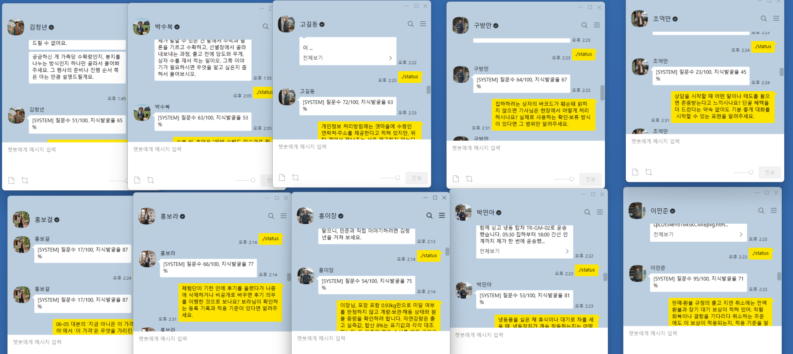

카카오임팩트가 주최한 [AI_TOP_100 2026](https://aitop100.org/) 온라인 예선에 개인으로 참여해, 카카오톡에서 고객 문의를 처리하는 ‘영호AI봇’을 제작했습니다. AI 도구를 활용해 관계자 인터뷰, 지식 정리, 챗봇 구현과 검증을 진행했습니다.

## 과제와 접근

예선은 2026년 10월 31일 10:00~15:00, 5시간 동안 진행됐습니다. 과제는 가상의 ‘교동마을 산지직송’에 흩어진 운영 지식을 모아 고객 응대 AI 에이전트를 만드는 일이었습니다. 규정집뿐 아니라 생산자·배송 담당자의 설명, 홍보물과 과거 상담에서 처리 조건과 예외를 찾아야 했습니다.

대회 전에는 전용 Linux 서버와 카카오톡 봇을 연결해 실제 답장을 확인했습니다. 당일에는 가상 관계자에게 질문하고 소개받은 인물로 대화를 넓혀 갔습니다. 수집한 답변과 문서는 출처·시점·적용 조건별로 정리하고, 서로 다른 설명은 원문과 대조했습니다.

## 관계자 인터뷰와 지식 수집

배송 지연, 환불·보상, 상품 상태, 체험 행사 등 고객 문의에 필요한 정보를 수집했습니다. 담당자가 직접 처리하는 업무와 승인권자의 판단이 필요한 업무를 구분하고, 답변에서 확인되지 않은 내용은 후속 질문으로 남겼습니다. `./status`로 관계자별 질문 수와 지식 발굴률을 확인하며 질문을 조정했습니다.

대회 중 가상 관계자들과 대화한 화면입니다. 창마다 마지막 상태를 확인한 시각이 다르며, 표시된 지식 발굴률은 해당 시점의 수집 현황입니다.

## 챗봇 구현과 자체 검증

Python 봇이 카카오 게이트웨이에서 메시지를 받아 GPT API와 대회 액션 API를 연결하도록 구현했습니다. 수집한 문서를 검색해 정책을 확인하고, 주문·배송 정보를 조회한 뒤 고객의 선택에 따라 요청을 접수하거나 담당자에게 이관하도록 구성했습니다. SQLite에 대화 상태와 처리 기록을 저장해 재시작 이후에도 중복 접수를 방지했습니다.

2026년 10월 31일 14:58 기준 최종 검증 기록은 다음과 같습니다.

| 항목 | 확인한 내용 |
| --- | --- |
| 지식 자료 | 원문 54개를 검색용 조각 354개로 구성 |
| 공개 테스트 자체 검증 | 실제 모델·공식 연습 API를 사용한 전체 실행에서 15/15 통과 |
| 회귀 검사 | Windows와 Ubuntu 배포 환경에서 같은 코드로 88/88 통과 |

공개 테스트는 합성 후속 발화를 사용한 자체 검사이며 공식 채점 결과와는 구분됩니다. 회귀 검사에는 정책 문구 확인도 포함됩니다. 최종 수정 버전으로 카카오톡 전체 흐름과 비공개 평가 사례까지 검증하지는 못했습니다.

## 참여 결과

온라인 예선에 참여했으며, 예선에서 탈락해 본선에는 진출하지 못했습니다. 결과는 2026년 11월 4일 확인했습니다. 관계자 인터뷰로 운영 지식을 모으고, 이를 카카오톡 챗봇과 액션 API에 연결한 과정을 참여 기록으로 남깁니다.
