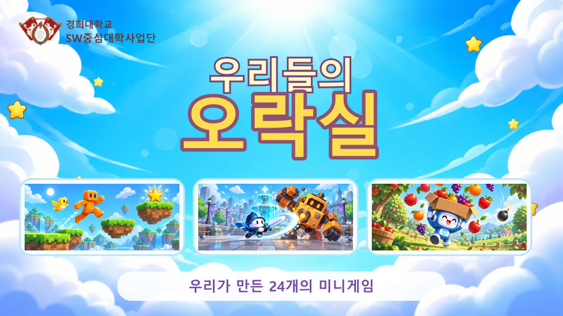
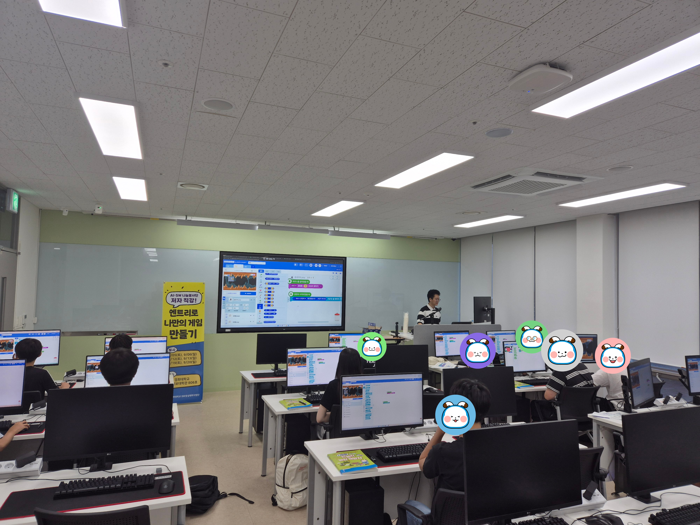
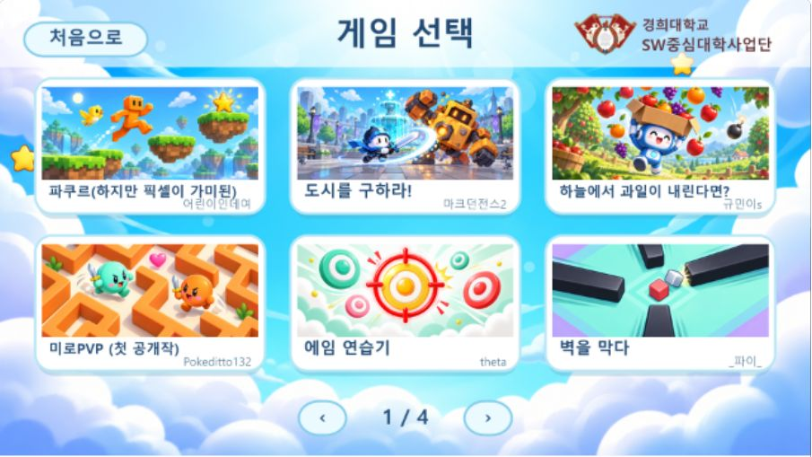
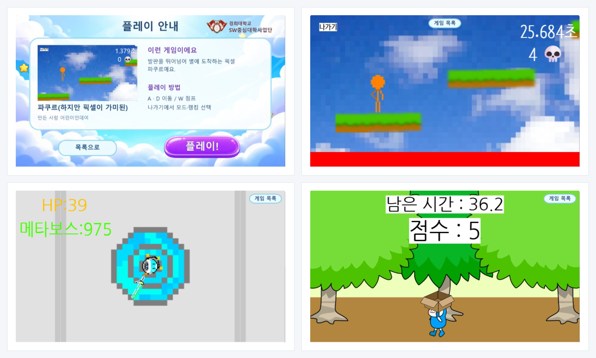
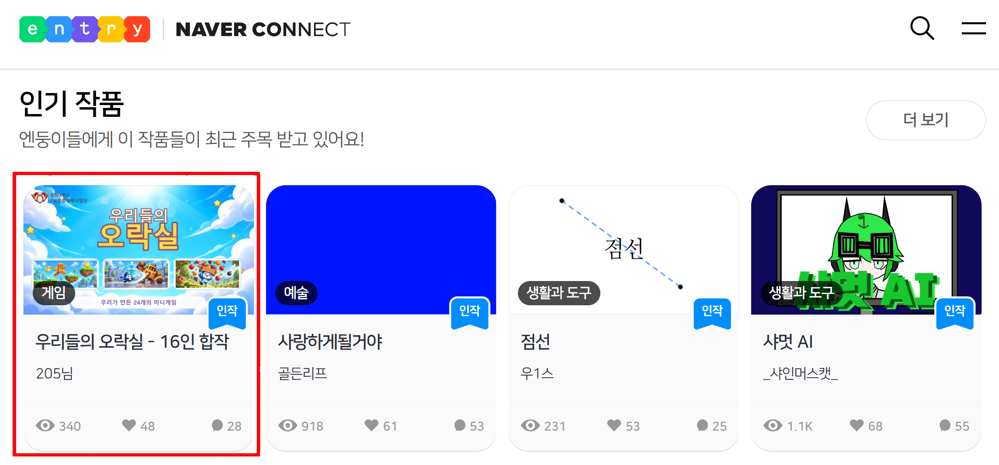
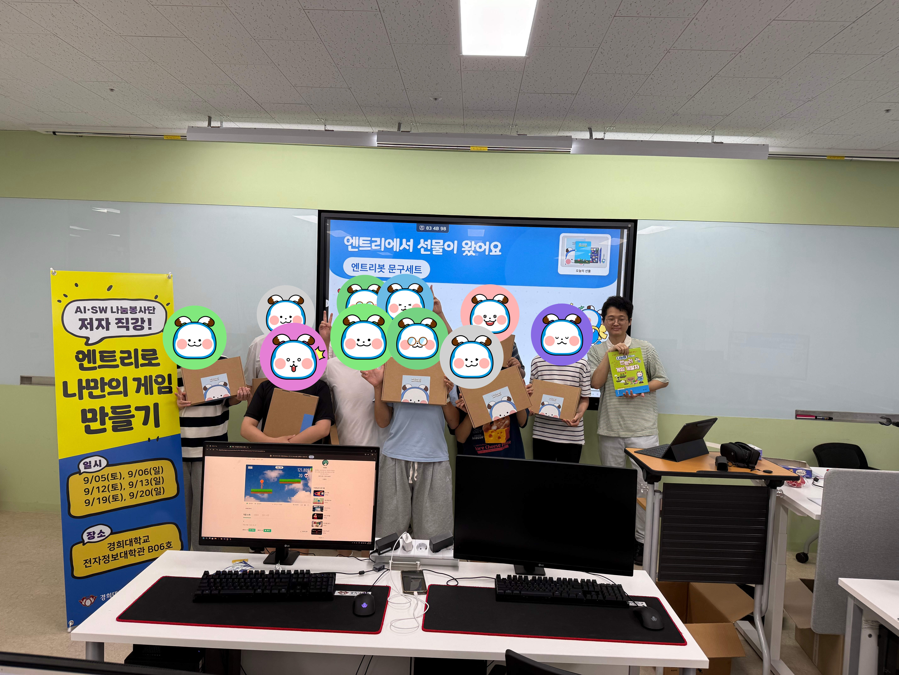

공저한 [『나는야 엔트리 게임 개발자 - 스태프 선정 & 인기 작품 따라 만들기』](/projects/entry/education/entry-book-2/)를 교재로 중학생 대상 무료 코딩 수업을 진행했습니다. 2026년 9월 5일부터 20일까지 주말 6회·총 18시간 동안 게임 제작을 지도했고, 학생들의 작품을 24개 미니게임 모음집 「우리들의 오락실 - 16인 합작」으로 묶어 공개했습니다. 공동 결과물은 엔트리 인기 작품에 선정되었습니다.

## 한눈에 보기

| 구분 | 내용 |
|---|---|
| 프로그램 | 저자 직강! 엔트리로 나만의 게임 만들기 |
| 기간 | 2026.09.05–09.20, 토·일 총 6회·18시간 |
| 수업 시간 | 매회 14:00–17:00 |
| 장소 | 경희대학교 국제캠퍼스 전자정보대학 B06 실습실 |
| 대상·모집 | 중학생, 11개 학교에서 17명 신청 |
| 주최·운영 | 경희대학교 SW중심대학사업단 · AI·SW나눔봉사단 |
| 교육 방식 | 무료 대면 실습, 교재 1인 1권 무상 제공 |
| 공동 결과물 | 「우리들의 오락실 - 16인 합작」, 24개 미니게임 |
| 공개 성과 | 2026.09.20 엔트리 공개, 인기 작품 선정 |

## 맡은 역할

교재 저자이자 강사로 예제 제작부터 개인 게임 제작과 발표까지 지도했습니다. 실습 시간에는 학생 도우미와 함께 학생별 진행 상황을 확인했습니다.

| 역할 | 수행 내용 |
|---|---|
| 저자 직강 | 교재의 게임과 핵심 개념을 수업 진도에 맞춰 설명하고 제작 과정을 시연 |
| 실습·개별 지도 | 엔트리 학급 기능으로 제출 작품을 확인하고 개인 게임 제작 중 개별 지도 |
| 결과물 정리·공개 | 학생 작품을 게임 선택·설명·플레이 화면을 갖춘 공동 모음집으로 정리해 강사 계정에 공개 |

## 6회 수업 과정

첫 4회차에는 교재 게임을 만들며 변수와 신호부터 함수·재귀함수·리스트까지 배웠습니다. 4회차 후반부터 개인 게임을 기획하고, 마지막 2회차에는 제작과 발표를 진행했습니다.

| 차시 | 날짜 | 주요 활동 | 학습 개념 |
|---|---|---|---|
| 1회차 | 9월 5일 | 「블록을 부셔라」 입문 활동, 「점퍼」, 「얌얌식당」 | 변수, 신호 |
| 2회차 | 9월 6일 | 「RE:지메」, 「미끌미끌 스케이트」 | 복제본, 충돌처리, 함수 |
| 3회차 | 9월 12일 | 「진격의 공」, 「오븐파쿠르」 | 개인변수, 재귀함수 |
| 4회차 | 9월 13일 | 「3D 런」, 랭킹 시스템, 개인 게임 기획 | 리스트 |
| 5회차 | 9월 19일 | 개인 게임 제작, 개별 지도와 중간 점검 | 배운 개념의 종합 적용 |
| 6회차 | 9월 20일 | 작품 발표·시연, 서로 플레이하며 피드백, 수료 활동·만족도 조사 | 설명과 공유 |

학생들은 대형 화면의 설명을 듣고 교재와 자신의 실습 화면을 함께 보며 게임을 만들었습니다. 같은 개념을 배운 뒤에는 각자 정한 규칙에 적용하여 서로 다른 게임을 완성했습니다.

*교재를 보며 게임을 제작하는 실습 장면입니다. 학생 얼굴은 기존 가림 처리본을 사용했습니다.*

## 학생 작품과 공개 성과

「우리들의 오락실 - 16인 합작」에는 수업에서 만든 게임과 직접 기획한 게임을 함께 담았습니다. 게임 선택 화면은 네 쪽이며 24개 미니게임을 담고 있습니다. 설명과 조작 방법을 확인하고 플레이한 뒤 목록으로 돌아가 다른 작품을 고르는 방식입니다.

*게임 선택 화면의 첫 번째 쪽입니다. 제작자는 공개 작품에 사용된 엔트리 닉네임으로 표기했습니다.*

파쿠르 게임에는 진행 시간과 실패 횟수를, 「도시를 구하라!」에는 체력을, 「하늘에서 과일이 내린다면?」에는 남은 시간과 점수를 표시했습니다. 학생들은 같은 수업에서 배운 개념으로 서로 다른 게임 규칙을 구현했습니다.

공동 작품은 2026년 9월 20일 공개했고 엔트리 인기 작품에 선정되었습니다. 수업 밖의 이용자도 학생들이 만든 게임을 플레이하게 되었습니다.

*2026년 9월 22일 최종 결과보고서에 수록한 선정 화면입니다. 화면의 조회·좋아요 수는 당시 기록입니다.*

## 학생들의 반응과 다음 수업

마지막 수업에서 진행한 만족도 조사의 유효 응답은 11건입니다. 코딩 인식 변화와 후속 활동 참여 의향을 다음과 같이 집계했습니다.

| 문항 | 응답 | 건수 / 유효 응답 | 비율 |
|---|---|---|---|
| 코딩에 대한 생각의 변화 | 훨씬 재미있어졌어요 | 9 / 11 | 81.8% |
| 코딩에 대한 생각의 변화 | 조금 재미있어졌어요 | 2 / 11 | 18.2% |
| 엔트리 게임잼 참여 의향 | 꼭 참여하고 싶어요 | 8 / 11 | 72.7% |

수업 후 자기보고 설문 결과이며, 사전·사후 능력 점수를 비교한 자료는 아닙니다. 응답 수 11건을 기준으로 해석했습니다.

자유 의견에서는 친절한 지도와 코딩 경험, 재미를 언급했습니다. 수업 횟수·시간 확대와 시험 기간을 고려한 일정에 대한 의견도 있었습니다. 다음 운영의 개선 과제는 개인 제작·발표 시간 확보와 학교 시험 일정을 고려한 일정 조정입니다. 게임잼 참여 의향은 후속 활동을 기획할 때 참고할 자료입니다.

## 수료 활동과 운영 지원

교재 무상 제공과 컴퓨터 실습실, 학생 도우미의 지원으로 수업을 운영했습니다. 엔트리(네이버 커넥트재단)에서 지원받은 엔트리봇 문구세트 20개는 수료 활동에 활용했습니다.

*마지막 수업의 단체 기념사진입니다. 학생 얼굴을 가린 기존 파일을 사용했습니다.*

프로그램 모집 당시의 언론 보도는 [언론 보도 기록](/projects/etc/press/)에 정리했습니다.
