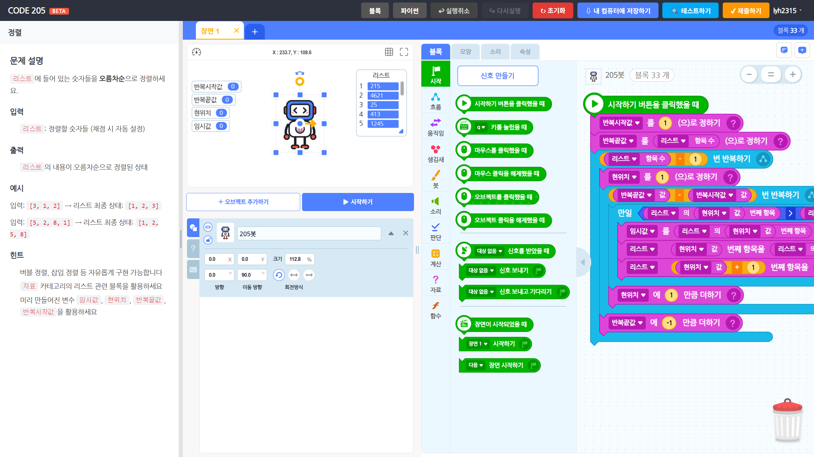

블록 코딩으로 알고리즘 문제를 푸는 플랫폼입니다. 좌측 지문을 읽고 우측 엔트리 에디터에서 블록을 조립하면, 그 풀이를 **브라우저가 테스트 케이스로 자동 채점**합니다.

> **상표**: "205"®는 대한민국 특허청에 출원된 등록 상표입니다(출원번호 40-2023-0165693).
> **Attribution**: 런타임 엔진으로 [entrylabs/entryjs](https://github.com/entrylabs/entryjs)(Apache 2.0)를 사용하며, Entry Labs의 공식 서비스가 아닙니다.

## 화면 구성

- **메인** — 문제를 카드로 보여주고 난이도를 별(0~5)로 표시합니다. 해결한 문제에는 ✓ 배지를 달고, 난이도·해결 여부 필터 상태는 localStorage에 보존합니다.
- **에디터** — 좌측 문제 설명(Markdown, 드래그로 크기 조절) + 우측 엔트리 블록 코딩 워크스페이스·스테이지. 블록/파이썬 모드 전환, 실행취소/다시실행, 테스트/제출, 내 컴퓨터에 저장하기.
- **회원 페이지** — 가입/로그인과 프로필(기본 정보·풀이 통계·내가 푼 코드·비밀번호 변경·데이터 초기화·계정 삭제).

## 채점 시스템

- **전량 로컬 채점** — 채점이 전부 브라우저에서 돌기 때문에 서버 부하가 없습니다.
- **테스트하기**(공개 케이스, 실패 상세 공개) / **제출하기**(숨김 케이스, 상세 비공개)로 나뉩니다.
- 채점 중에는 **화면 차단 모달**이 진행 현황만 보여주면서 ⏹ 중단 버튼·키보드·엔진 버튼을 막습니다.
- 무한 반복 같은 **시간 초과**(기본 5초)와 빨간 경고 블록으로 드러나는 **오류**를 함께 감지해 처리합니다.
- 블록과 파이썬 **두 모드를 똑같이 채점**하고, `묻고 기다리기(대답)` 자동 응답도 지원합니다.

## 작품 합치기 (`/merge`)

여러 엔트리 작품(`.ent`)을 하나로 합치는 도구를 플랫폼에 통합했습니다.

- **전량 클라이언트 사이드 처리** — 파일이 서버로 올라가지 않으니 안전하고, 서버 부하도 0입니다.
- 장면 ID를 난수화해 충돌을 막은 다음 오브젝트·변수·리스트를 재귀로 병합합니다(`대답`·`초시계` 등 특수 변수는 중복 제거).
- 파일당 50MB · 전체 150MB · 최대 10개, 바이트 가중 진행률, gzip 스트리밍. 병합 엔진은 `entry-merge-extension` 로직을 이식했고, 순수 함수는 단위 테스트로 검증합니다.

## 회원 기능 (선택)

- **비회원도 핵심 기능을 그대로** 쓸 수 있습니다. 가입은 서버 동기화·코드 보관·통계를 원할 때 고르는 선택지입니다.
- **풀이 기록 동기화** — 정답을 통과하면 `solutions` 테이블에 등록하고, 로드할 때 localStorage ↔ 서버를 양방향으로 병합합니다.
- **정답 코드 자동 저장·복원** — 통과한 풀이는 `Entry.exportProject` 결과(≤100KB)를 문제당 최신 1개씩 저장해 두었다가, 다시 들어오면 "내 풀이 불러오기" 모달을 띄웁니다.
- 가입 정책은 username 3~20자(lowercase로 정규화해 사칭 차단), 비밀번호 8자 이상 + 영문 + 숫자, 14세 이상입니다. 비밀번호는 **bcrypt(cost 10) 해시로만** 저장합니다.

## 내 컴퓨터에 저장하기 (.ent 내보내기)

현재 작품을 엔트리 호환 `.ent`로 재번들해 내려받습니다. 서버는 자산을 엔트리 공식 포맷(`temp/<aa>/<bb>/...`)으로 재배치하고, SVG는 `sharp`로 PNG 래스터와 96px 썸네일까지 함께 번들합니다. 그래서 playentry.org 오프라인 불러오기와도 호환됩니다.

## 보안

- **XSS** — 모든 문자열을 `escapeHtml`/`renderMarkdown`을 거쳐 렌더링하고, XSS 회귀 테스트 5종으로 가드합니다.
- **CSP** — 정적 페이지에 `default-src 'self'` + `frame-ancestors 'none'` 등 strict 정책을 적용합니다(엔트리 런타임 호환을 위해 에디터·`/lib/*`만 예외).
- 세션 쿠키 `httpOnly` + `sameSite=lax` + `secure` + 7일, 가입·로그인 IP rate-limit, prepared statement(SQL 인젝션 차단), 숫자 id 정규식으로 path traversal 차단, 탈퇴 시 외래키 CASCADE 정리.

## 운영 · 배포

- **인프라**: Oracle Cloud ARM A1(Always Free, 2 OCPU / 12 GB) · Ubuntu 22.04 · Nginx(gzip · rate limit · TLS) · Let's Encrypt(certbot) · PM2(+ logrotate). SSH 키 인증 · fail2ban · 방화벽 2겹 · OCI 예산 알림으로 하드닝.
- **CI/CD**: `main` push → GitHub Actions가 테스트 → SSH 배포 → 헬스 체크(HTTP 200)까지 약 25초입니다. 동시 배포를 막고, 문제가 생기면 `git revert`로 롤백합니다.
- **테스트**: 순수 함수와 모든 인증·데이터 라우트를 Node 내장 `node:test`로 검증하며, 236개 단위·통합 테스트를 통과해야 배포됩니다.

## 기술 스택

`EntryJS 4.0.22` · `Node.js 20+` · `Express` · `helmet` · `express-session` · `express-rate-limit` · `better-sqlite3 (SQLite WAL)` · `connect-sqlite3` · `bcryptjs` · `sharp` · `node:test` · `GitHub Actions → SSH 배포` · `Oracle Cloud · Nginx · PM2 · certbot`
