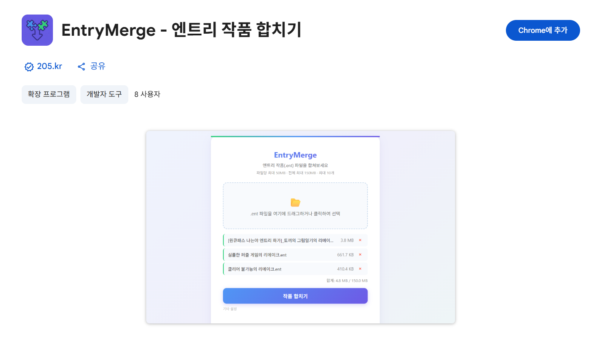

엔트리(Entry) 작품에 **세이브/로드 기능을 블록 몇 개로** 붙이는 크롬 확장입니다. 이름이 `@`로 시작하는 변수·리스트만 추적해 브라우저 localStorage에 저장하며, 모든 데이터는 기기 안에만 머물러 **외부 서버로 전송되지 않습니다.**

> 최소 사용법: ① 저장할 변수·리스트 이름 앞에 `@` 붙이기 → ② 매개변수 없는 함수 `@저장`을 원하는 시점에 호출. 작품이 실행되면 이전 저장본이 자동 복원됩니다.



## 주요 기능

- **자동 불러오기** — 작품이 실행(`run`)되는 즉시 이전 저장본을 복원합니다. `/project/` 자동 실행, `/ws/` Play 버튼, `/noframe/` 임베드를 모두 대응합니다.
- **수동 저장 `@저장`** — 호출하는 순간 `@확장프로그램`을 제외한 모든 `@` 변수·리스트를 저장합니다. 저장 시점은 메뉴 저장 버튼이든 스테이지 클리어든 창작자가 자유롭게 정합니다.
- **교차 작품 불러오기 `@가져오기`** — 다른 작품의 세이브를 현재 작품으로 가져옵니다. 시리즈 1편의 엔딩 데이터를 2편에서 이어받는 식입니다. 파라미터로 대상 작품 ID를 받아 **현재 작품에도 같은 이름으로 있는** `@` 변수·리스트만 복원합니다.
  ```
  @가져오기 [69b3ef8e0075070c7c1d0aca]   ← 다른 작품의 project ID
  ```
- **확장 설치 감지 `@확장프로그램`** — 같은 이름의 변수를 만들어두면 확장이 켜진 채 실행될 때 자동으로 `1`이 됩니다. "확장을 켜야 세이브가 됩니다" 같은 안내를 조건부로 띄울 때 씁니다. v1.3.8부터는 **예약 변수로 승격돼 저장·복원 대상에서 제외**됩니다 — 저장본이나 교차 작품 가져오기가 설치 플래그를 덮어쓰지 않습니다.
- **만들기/작품보기 데이터 분리** — `/ws/`(만들기)와 `/project/`(작품보기)가 **다른 저장 공간**을 써서, 제작 중 테스트 데이터와 플레이어 진행도가 섞이지 않습니다.
- **데이터 관리 팝업** — 현재 작품 / 모든 작품 초기화를 지원합니다(현재 페이지 namespace 기준).

## 기술적 특징

- **Manifest V3** + **MAIN world 주입**으로 `window.Entry` 엔진 내부 상태·함수에 직접 접근합니다.
- **삼중 실행 감지** — ① `Entry.engine.toggleRun` 후킹(Play 버튼), ② 상태 폴링(`stop → run` 전이), ③ 진입 시 이미 `run`이면 즉시 로드(`/project/` 자동 실행).
- **signature 기반 후킹 관리**(`_isSaveMgrHook`) — URL이 바뀔 때 자기 래퍼만 정확히 복구해 중복 래핑·좀비 후킹을 막습니다.
- **SPA Mutation Observer**로 라우팅이 바뀌면 재주입하고, 자식 iframe은 **postMessage 핸드셰이크**로 부모의 페이지 타입(ws/project)을 안전하게 넘겨받습니다.
- v1.3.7에서는 작품보기 전체화면(⛶) 시 `Entry.engine`이 새 객체로 교체되며 후킹이 끊기던 문제를 잡았습니다. 폴링에 engine 교체 감지를 넣어 즉시 재후킹하도록 했습니다.
- v1.3.8에서는 `@확장프로그램`을 예약 변수로 분리하고, 검증·패키징 스크립트를 추가했습니다. 스토어 빌드는 match 도메인을 `playentry.org` 전용으로 좁히고, `@저장`이 정의되지 않은 작품에서 나던 콘솔 에러를 침묵시켰습니다.

## 저장 키 규칙

| 페이지 | 키 형식 |
|---|---|
| `/project/<id>` · `/noframe/<id>` | `entry_save_<id>` |
| `/ws/<id>` | `entry_save_ws_<id>` |
| `@가져오기(<otherId>)` | `entry_save_<otherId>` (항상 작품보기 데이터) |

## 안전성 · 개인정보

- 추적 대상은 **`@` 접두사 변수/리스트**로만 한정합니다.
- 로드 시 **primitive 타입(number·string·boolean) 검증**으로 변조된 객체·함수 주입을 차단합니다.
- 손상된 JSON은 항목별로 건너뛰고 나머지는 정상 복원하며, 대상 project ID는 hex 패턴을 검증한 뒤 접근합니다.
- 모든 데이터는 **기기 내부(localStorage)** 에만 저장되고 네트워크 전송은 없습니다.

## 기술 스택

`Chrome Extension (Manifest V3)` · `Vanilla JS` · `MAIN world 후킹` · `localStorage`
