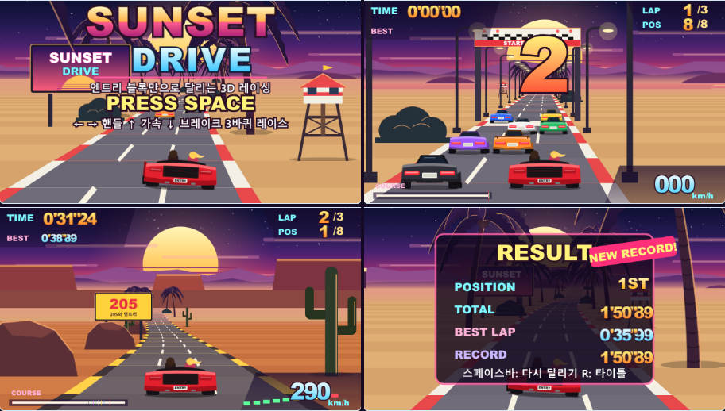

AI 코딩 도우미에게 만들고 싶은 게임을 설명하면, 엔트리에서 열고 수정할 수 있는 `.ent` 작품을 만드는 개발 환경입니다. AI가 생성 도구와 로컬 편집기를 쓰고, 테스트 결과를 읽어 작품을 고치는 과정까지 연결했습니다. 저는 이 작품 제작·자동 검증 환경을 구축했습니다.

블록을 직접 끌어다 놓는 대신 AI가 코드로 작품을 설계합니다. 완성된 파일에는 엔트리 블록과 그림·소리가 들어가므로, 사용자는 익숙한 엔트리 편집기에서 결과를 확인하고 이어서 작업할 수 있습니다.

## 대표 작품 · SUNSET DRIVE

엔트리 기본 블록으로 만든 유사 3D 레이싱 게임입니다. 노을 진 해변에서 출발해 숲과 협곡을 지나며, 라이벌 7대와 3바퀴를 달립니다. 커브·언덕·추월·충돌, 순위와 랩 기록, 배경음악과 엔진음까지 한 작품에 담았습니다.

<figure>
  <picture>
    <source media="(prefers-reduced-motion: reduce)" srcset="/media/entry-vibe-coding/sunset-drive-poster.png">
    
  </picture>
  <figcaption>SUNSET DRIVE 실제 주행 화면 · 원본 APNG, 480×270 · 21프레임 · 약 2.62초 반복</figcaption>
</figure>

게임은 별도의 JavaScript 실행 파일이나 확장 프로그램 없이 `.ent` 안의 블록으로 동작합니다. 재귀 함수로 도로를 원근 투영한 뒤 엔트리의 붓과 도장 블록으로 도로·차·풍경을 그립니다. 프레임이 늦어지면 그리는 거리를 줄입니다. 이동량은 실제 시간에 맞춰 계산합니다.

| 구성 | 내용 |
|---|---|
| 경기 | 플레이어 1대와 라이벌 7대, 3바퀴 레이스 |
| 화면 | 해변·숲·협곡, 커브와 언덕, 계기판·코스 지도·결과 화면 |
| 소리 | 배경음악·엔진·카운트다운·충돌 등 MP3 8개 |
| 작품 구조 | 오브젝트 13개, 블록 3,031개, 그림 98개 |

## AI가 만들고 검증하는 흐름

AI는 저장소의 제작 지침과 예제를 읽고 작품을 설계합니다. 설계한 코드를 `.ent`로 바꿔 로컬 편집기에서 실행합니다. 오류가 나거나 예상과 다르게 움직이면 소스를 고쳐 다시 검사합니다.

| 단계 | 도구가 하는 일 | AI가 확인하는 결과 |
|---|---|---|
| 설계 | 자체 DSL 또는 JSON으로 오브젝트·변수·장면·함수 작성 | 게임 규칙과 블록 구조 |
| 정적 검사 | 블록 종류·인자·참조·ID·에셋 검사 | 잘못된 블록이나 누락된 파일 |
| 작품 생성 | 그림·소리와 프로젝트 데이터를 `.ent`로 묶기 | 엔트리에서 불러올 작품 파일 |
| 실행·관측 | Playwright와 Chromium으로 편집기 실행·입력 재현 | 변수·화면 픽셀·스크린샷·소리·오류 로그 |
| 수정·재검사 | 실패한 동작을 고친 뒤 같은 시나리오 실행 | 수정 결과와 기존 기능의 유지 여부 |

파일의 구조가 맞더라도 캐릭터가 반대로 움직이거나 키 입력이 먹지 않을 수 있습니다. 제작 과정에 실행 검사를 넣은 이유입니다. 파일 생성 성공과 실제 플레이 성공을 구분해 보고하도록 했습니다.

## 제작을 받치는 도구

### 엔트리 블록을 코드로 표현하는 DSL

엔트리 작품은 JSON이 깊게 중첩돼 직접 작성하기 번거롭습니다. 이를 줄이려고 `setVar`, `when.run`, `if_`, `repeat` 같은 작성 도구를 만들었습니다. 슬롯과 인자 구조는 생성기가 처리합니다. 블록 레지스트리는 `acorn`으로 엔트리 소스를 분석해 만듭니다. 2026년 10월 7일 확인 기준 474종의 메타데이터가 들어 있습니다.

### 공식 엔진을 사용하는 로컬 편집기

엔트리 엔진은 공식 배포본을 그대로 사용합니다. 오프라인 부팅, 작품 불러오기·저장, 테스트 연결에 필요한 처리는 편집기를 감싸는 코드에 두었습니다. 엔진 내부를 수정하지 않고도 생성한 작품을 실행하고 저장한 파일을 다시 불러와 검사할 수 있습니다.

설치 스크립트가 엔진과 편집기 모듈을 준비합니다. 다른 개발 환경에서도 같은 절차로 설치하도록 했습니다. Windows와 Ubuntu에서 새로 설치해 검증하는 CI도 구성했습니다.

### 테스트 결과를 다음 제작에 남기는 지식 문서

`.ent` 파일 구조, 블록 작성법, 입력 처리, 소리 재생, 엔진의 실행 특성을 문서로 정리했습니다. AI가 다음 작품을 만들 때 참고하도록 해결한 오류와 회귀 검사 기준도 남겼습니다. 처음 사용하는 사람에게는 별도 안내 페이지를 제공합니다. 여기서 환경 준비와 게임 제작 요청에 쓸 프롬프트를 복사할 수 있습니다.

## 스스로 테스트한다는 것

검증은 L1 정적 검사, L2 파일·에셋 구조 검사, L3 편집기 부팅·로드, L4 작품 실행 검사로 나눴습니다. L5는 사람이 편집기에서 직접 확인하는 선택 단계이며, 문서 링크 검사는 별도로 실행합니다.

SUNSET DRIVE의 검증 봇은 도로와 차량 상태를 읽고 키 입력을 보냅니다. 게임 변수를 강제로 바꿔 완주 상태를 만들지 않으며, 시나리오마다 새 브라우저에서 시작합니다. 소리도 파일의 존재뿐 아니라 디코딩·재생 호출·출력 신호를 확인합니다.

| SUNSET DRIVE 검사 | 통과 | 확인 내용 |
|---|---:|---|
| 부팅 | 11/11 | 타이틀·자동 주행·화면·작품 구조 |
| 조작 | 16/16 | 출발·가속·브레이크·조향·충돌·일시정지 |
| 소리 | 15/15 | MP3 등록·디코딩·재생·엔진 음높이·음소거 |
| 레이스 | 17/17 | 3바퀴 완주·1위·랩 기록·결과·재시작 |
| 저장 후 재실행 | 7/7 | 그림 98개·소리 8개·블록 3,031개 보존과 재실행 |

**2026년 9월 23일 `sunset-drive_002.ent` 검증 기록에서 66/66개 검사를 통과했고, 페이지·콘솔 오류는 0건이었습니다.** 로컬 헤드리스 Chromium과 `@entrylabs/entry` 4.0.20에서 얻은 결과입니다. 공식 사이트에서의 실행·저장과 모바일 조작, 사람의 음질 평가는 이 기록의 검증 범위에 포함하지 않았습니다.

## 공개 결과물

작품 생성기, 로컬 편집기, 테스트 도구, 예제와 지식 문서를 GitHub에 공개했습니다. 대표작의 제작 소스와 `.ent`, 검증 코드·기록도 공개했습니다. 작품을 직접 열어 보고, AI가 무엇을 만들었고 어떻게 확인했는지 살펴볼 수 있습니다.

사용 기술은 Node.js, Express, 자체 DSL, entryjs, sharp, acorn, Playwright와 Chromium입니다.
