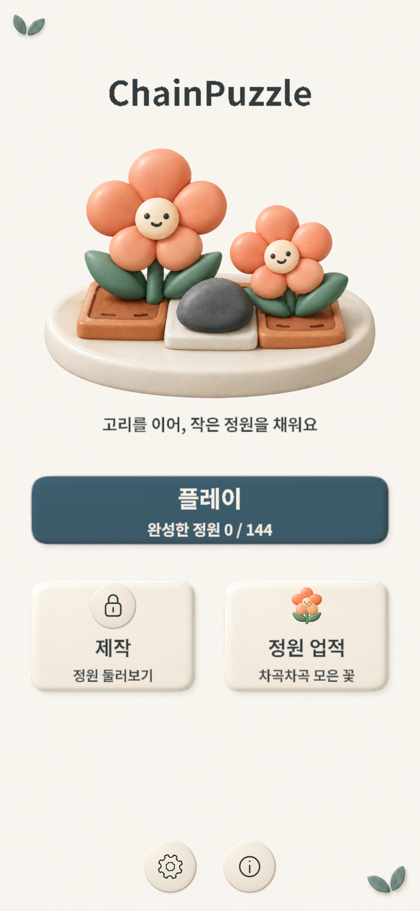
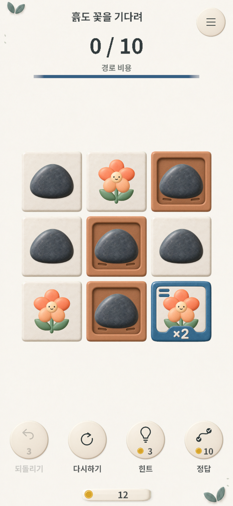
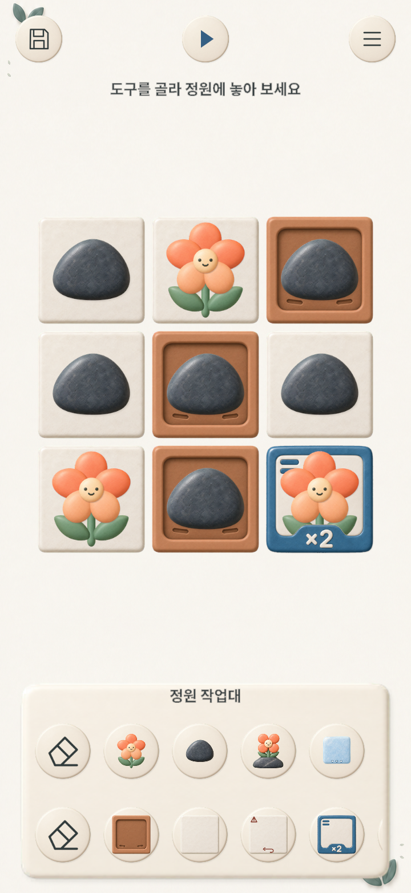
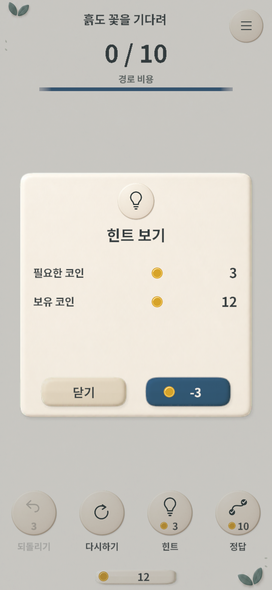

선을 그어 칸 위의 유닛을 한 칸씩 회전시키는 **그리드 기반 모바일 퍼즐 게임**입니다. "꽃을 흙 위로 옮긴다"는 단순한 목표에서 출발하지만, 타일과 유닛을 조합하면서 난이도가 차근차근 올라갑니다. 처음에는 **엔트리로 프로토타입**을 만들어 게임성을 검증한 뒤 Unity로 옮겼습니다.

## 한눈에 보기

| 항목 | 내용 |
|---|---|
| 장르 | 캐주얼 퍼즐 (선 잇기 / 순환 이동) |
| 엔진 | Unity 6 (6000.3.9f1), 2D URP |
| 플랫폼 | Android (세로 모드), `com.GDH.ChainPuzzle` |
| 버전 | 1.0.2 (최종 제출 versionCode 7) |
| 상태 | Google Play 출시 확인 (2026.10.08), 최종 소스 보관 완료 |
| 분량 | 기본 캠페인 144레벨 (12레벨 × 12페이지) + 사용자 제작 맵 |
| 언어 | 한국어 / 영어 / 일본어 (런타임 전환) |

## 실행 화면

| 메인 메뉴 | 캠페인 플레이 |
|---|---|
|  |  |

| 인게임 맵 에디터 | 힌트 구매 |
|---|---|
|  |  |

2026년 9월 29일 당시 작업본을 Unity Play Mode에서 직접 캡처했습니다. 720×1560 해상도이며, 별도 테스트 저장과 오프라인 설정을 사용했습니다. 에디터 화면은 도구가 해제된 테스트 진행 상태입니다.

## 역할 분담

개발 2명·아트 1명으로 시작한 프로젝트입니다. 초기 공동 개발의 역할 분담은 다음과 같습니다.

**본인 (이영호) 담당**
- **핵심 게임 제작** — 퍼즐 로직, 선 잇기·순환 이동, 게임 상태 머신, 타일/유닛 규칙 등 게임플레이 전반
- **맵 에디터** 및 플레이테스트 기반 정답·기준 경로 비용 자동 생성
- **Google Play 배포 준비** 및 **업적(Google Play Games) 연동**
- **초기 버전의 Spine 애니메이션 엔진 연동** — 디자이너가 만든 애니메이션을 게임 유닛에 적용

**협업**
- 개발 친구 — 홈(메인 메뉴)·레벨 선택·설정 화면, Firebase로 **사용자 제작 맵 불러오기**
- 디자이너 친구 — 꽃 / 돌꽃 유닛의 **Spine 2D 애니메이션 제작**

## 2026년 9~10월 — 캠페인·사용성 개선과 출시

초기 공동 개발 이후 진행 구조·화면·저장·온라인 연결을 점검했습니다. 실제 Android에서 발견한 입력 문제도 수정한 뒤 다시 검사했습니다.

### 144레벨 캠페인과 저장 호환성

기존 24레벨을 보존하면서 120레벨을 추가해 **144레벨 캠페인**을 적용했습니다. 화면에서는 12레벨씩 12페이지로 보여 주고, 학습은 기본 규칙·두 칸 이동·역방향·쓰레기·돌꽃·얼음의 6구간으로 구성했습니다. 레벨 선택·제작 도구 해금·다음 레벨 이동은 공통 진행 정책을 따릅니다.

저장 형식을 바꿀 때는 기존 진도와 제작 권한을 보존했습니다. 신규 권한은 1레벨부터 연속으로 클리어한 수에 따라 열립니다. 해금 소개가 중간에 끊기면 다시 보여 줍니다. 연출이 실제 버튼에 도착한 뒤 표시 완료를 저장합니다.

### 도자기풍 아트와 화면 개선

꽃·돌·화분 타일을 도자기풍 아트로 통일하고, 스프라이트 리그와 이동·착지 연출을 연결했습니다. 두 칸 이동 타일에는 ×2 표시를 넣어 규칙을 읽기 쉽게 했습니다. 메인 메뉴는 플레이를 중심으로 정리하고, 제작 화면에는 타일과 유닛을 고르는 두 줄 팔레트를 배치했습니다.

플레이 HUD에는 경로 비용과 보유 코인을 함께 표시했습니다. 힌트·정답 팝업은 취소와 구매 버튼의 위치를 통일하고, 필요한 코인과 잔액을 나눠 보여 줍니다. 한국어·영어·일본어에서 글자가 넘치지 않는지 확인하고, 작은 화면과 Safe Area도 검증했습니다. BGM은 화면 전환 시 교차 페이드하며 재생 위치를 유지하고, 효과음 19개도 게임 분위기에 맞게 재제작했습니다.

### 온라인 맵과 계정 연결

최신순·별점순·플레이 횟수순 정렬에 제목/제작자 검색, 기믹 필터, 내 맵 조건을 조합했습니다. 목록을 기다리다 화면을 나가거나 조건을 바꾸면 이전 요청의 응답을 버립니다. 오프라인에서도 로컬 슬롯과 맵 제작을 사용할 수 있습니다.

실기기에서 발생한 Firebase `Auth/UserMismatch`를 조사하고, 기존 계정을 보존하는 취소 흐름과 동의를 받은 계정 변경을 구현했습니다. 운영 목록의 색인과 기존 공개 맵 필드도 보완했습니다. 중복 업로드 방지, 사용자별 평점과 트랜잭션 집계, 신고·차단도 구현했습니다. 운영 검증이 남은 항목은 따로 관리합니다.

### Android 입력과 출시 절차

Android에서 짧은 뒤로가기 입력이 빠지거나, 키보드를 닫으려다 화면까지 나가는 문제를 추적했습니다. 네이티브 Back 전달과 키보드 가장자리 입력 처리를 보완하고, LG V50에서 재검증했습니다. 맵 제목은 3~15자, 힌트는 3코인, 정답은 10코인으로 표시·차감·취소 동작을 맞췄습니다.

2026년 9월 21일, 빙글정원 1.0.2/code6를 대한민국·일본·미국 대상으로 Google Play 심사에 제출했습니다. Play Games 서비스의 인증 설정과 업적 게시도 완료했습니다.

### Google Play 출시와 최종 보관

10월 2일 심사에서 스토어 이름과 기기에 설치된 앱 이름의 불일치가 지적됐습니다. 패키지 ID와 기존 저장 경로는 유지하면서 Android 표시 이름을 **빙글정원**으로 맞췄습니다. 최신 메인 화면·플레이 HUD·힌트 안내 개선을 포함한 **1.0.2/versionCode 7**을 검증한 뒤 10월 3일 다시 제출했습니다.

**2026년 10월 8일, Google Play 공개 페이지에서 빙글정원과 설치 버튼을 확인했습니다.** 10월 8일은 출시 확인일입니다. 최종 소스와 출시·검증 기록은 Unity Version Control의 `/main`(cs268)과 GitHub의 `main`(6e8f99f)에 반영해 보관했습니다.

### 검증 기록

아래는 각 작업 당시 남긴 실행 결과입니다. 서로 다른 버전과 환경의 수치를 합산하지 않았습니다.

| 검증 범위 | 확인한 결과 | 남은 확인 |
|---|---|---|
| 9월 23일 UI 개선 | Unity 화면·레이아웃 985개, Safe Area·입력 23개, 구매·Back·입력 회귀 131개 검사 통과 | 10월 3일 code7에서 주요 흐름 재검증, IME·일부 편집 동작은 남음 |
| 같은 UI 변경본 Android 빌드 | Unity 6000.3.9f1, 오류 0·경고 3, 로컬 비개발 APK 생성 | 디버그 서명 검증본으로, 스토어 제출본과 구별 |
| 9월 20일 Android Back 수정 | LG V50에서 케이스 묶음 34개 통과·4개 미실행 | 사람 손/OS IME 대조와 일부 편집 동작 |
| 9월 21일 계정·목록 수정 | LG V50에서 계정 변경·취소·재실행·온라인 목록 등 14개 검사 통과 | 평점·강화 rules 등 온라인 후속 인수 |
| 10월 3일 최종 제출본 | Unity UI 회귀 131개 검사 통과, Release AAB 오류 0·경고 76 | 16KB 메모리 페이지 크기 실제 기기 검사 |
| 10월 3일 Play 업데이트 | LG V50(Android 12)에서 code6→7 업데이트 후 저장 파일 3개 동일·기존 계정 재연결 확인 | 신규 설치 인증·다른 기기·IME와 일부 구매 동작 |

144레벨 데이터 통합을 완료했고, 기존 QA의 잔여 항목도 보관했습니다. 남은 범위는 125레벨 전수 실기기 플레이, 신규 설치 인증, 다른 기기와 16KB 메모리 페이지 크기 환경, 일부 IME·구매 동작 및 온라인 운영 검증입니다.

## 게임 소개

플레이어는 격자 위에서 상하좌우로 인접한 칸을 이어 **시작 칸으로 돌아오는 고리**를 그립니다. 고리가 닫히면 경로 위의 유닛들이 **순환 이동**합니다. 꽃과 돌꽃으로 흙 타일을 모두 채우고 얼음의 이동 제한을 지키면 클리어입니다.

> 고리 위에 놓인 유닛만 이동합니다. 고리 안쪽 영역 전체가 움직이는 방식은 아니며, 닫기 전에 손을 떼면 경로를 취소합니다.

규칙은 한 문장이지만, 타일과 유닛 속성이 더해지면 경로를 거꾸로 돌려야 하거나 두 칸씩 밀어야 하는 상황이, 또 같은 유닛을 너무 많이 건드리면 안 되는 상황이 생깁니다.

## 핵심 게임플레이

### 타일 (바닥 속성)

| 타일 | 설명 |
|---|---|
| 흙 (Dirt) | 목표 칸. 위에 꽃 / 돌꽃이 있어야 정답 |
| 일반 (Normal) | 아무 제약 없는 기본 칸 |
| 쓰레기 (Trash) | 꽃이 올라가면 실패 → 자동으로 이동 취소. 단, 돌꽃은 허용 |
| 더블 (Double) | 이 칸을 지나는 경로는 **2칸씩** 이동 |
| 역방향 (Reverse) | 이 칸을 지나는 경로는 **반대 방향**으로 이동 (더블과 겹치면 반대로 2칸) |

### 유닛 (칸 위의 말)

| 유닛 | 설명 |
|---|---|
| 꽃 (Flower) | 흙 위로 옮겨야 하는 주인공. 현재 버전은 도자기풍 스프라이트 리그로 표현 |
| 돌 (Stone) | 장애물 겸 채움 유닛. 클리어 시 화면 밖으로 튕겨 나가는 연출 |
| 돌꽃 (StoneFlower) | 여분의 꽃. 흙·쓰레기 모두 허용되는 예비 정답 유닛 |
| 얼음 (Ice) | **이동 횟수가 3회 미만이어야 클리어 가능.** 이동·취소·리셋에 따라 카운트와 이미지를 갱신 |

### 조작과 이동

- **인접 판정**: 상하좌우 1칸만 연결(대각선 불가), 이미 지난 칸 재방문 금지로 꼬임 방지.
- **도형 완성**: 상하좌우로 최소 4칸을 연결하고 시작 칸으로 돌아오면 경로 확정.
- **순환 이동**: 경로 위 유닛들을 모듈러 연산으로 한 칸씩 회전. `step` 값 하나로 일반(+1)·더블(+2)·역방향(-)을 모두 처리.
- **되돌리기 / 리셋 / 힌트 / 정답**: 되돌리기 최대 3회, 힌트 3코인, 정답 자동 재생 10코인. 경로 비용은 드래그 횟수가 아닌 경로 길이의 합계로 셉니다.
- **정답/실패 판정**: 모든 칸이 조건을 만족하면 승리, 꽃이 쓰레기 칸에 놓이면 그 즉시 이동을 자동으로 되돌립니다.

## 진행 구조

- **144레벨 캠페인**을 12개씩 12페이지로 나눕니다. 레벨을 깨면 다음 레벨이 열리며, 학습 구간은 24개씩 6구간입니다.
- **진행 상태 4단계**: 잠김 → 해제 → 클리어 → **퍼펙트 클리어**(저장된 기준 경로 비용 이내 클리어).
- **코인 경제**: 클리어 1코인, 퍼펙트 3코인 보상(상태가 오를 때 차액만 지급). 힌트·정답에 코인을 씁니다.
- **제작 도구 해금**: 24레벨 연속 클리어로 기본 에디터, 이후 48·72·96·120·144레벨에서 더블·역방향·쓰레기·돌꽃·얼음 도구를 엽니다. 중앙 소개에서 실제 버튼으로 이어지는 해금 연출을 연결했습니다.

## 맵 에디터 & 커스텀 맵 공유 (대표 기능)

단순 플레이를 넘어, **유저가 직접 맵을 만들고 공유**할 수 있는 파이프라인을 구현했습니다.

1. **인게임 에디터**: 그리드에 타일/유닛을 찍어 맵을 만듭니다. 기존 레벨을 불러와 수정하는 모드(Edit)도 지원합니다.
2. **제작 검증**: 빈 칸 위 유닛 금지, 모든 칸 채우기, `꽃 수 ≤ 흙 수 ≤ 꽃 + 돌꽃` 균형, 최소 1송이 필요 등 보드 형식과 배치 조건을 코드로 검증합니다. 풀이 여부는 이어지는 플레이테스트에서 확인합니다.
3. **플레이테스트 → 정답 자동 생성**: 제작자가 자기 맵을 직접 풀면, 그 **풀이 경로를 정답으로, 경로 길이 합계를 기준 비용으로** 기록합니다. 이 값은 최단 해법을 증명한 결과와 구별합니다. "클리어해야 업로드 가능"이라는 규칙이 곧 정답 데이터 검증인 셈입니다.
4. **공유**: 완성한 맵을 Firebase Firestore에 업로드합니다. 다른 유저는 **최신순 / 별점순 / 플레이 횟수순**에 제목·제작자 검색과 기믹 필터를 조합해 맵을 찾아 플레이합니다.

> 게임 모드는 `Normal / PlayTest / Custom / Edit` 4종으로 나뉘며, 같은 게임 씬이 모드에 따라 다르게 동작합니다.

## 기술 구조

혼자 처음 만들었던 이전 프로젝트들의 시행착오를 정리해, **확장 가능한 구조 설계**에 집중한 프로젝트입니다.

### 매니저 허브 패턴
`Managers` 싱글톤 하나가 `DontDestroyOnLoad`로 살아남아 10개 하위 매니저(Data·Firebase·Input·Localization·Level·Resource·Scene·Setting·Sound·UI)에 정적 프로퍼티로 접근합니다. 어디서든 `Managers.Sound.Play(...)` 식으로 일관되게 호출합니다.

### 유한 상태 머신(FSM)으로 게임 흐름 관리
게임 진행을 `GameState`(Idle·Draw·Move·Result·UndoMove·GameWin·ResetLevel·Hint·Answer) 열거형으로 정의하고, `SetState()` 한 곳에서 상태 전이와 부작용을 통제했습니다. 입력·이동·판정·연출이 상태별 함수로 나뉘어 흐름을 따라가기 쉽습니다.

### 데이터 기반 레벨
레벨을 **압축 문자열**로 표현했습니다. 예를 들어 `tile_data: "111111112000121"`, `unit_data: "000110000000000"`처럼 한 칸을 한 글자로 인코딩해 `width × height` 격자로 복원합니다. 레벨은 JSON으로 관리하고 `ILoader` 제네릭 패턴으로 로드해 `Dictionary<int, Level>`로 변환합니다(Newtonsoft.Json).

### UI 프레임워크
`UI_Base`에서 **열거형 이름으로 자식 오브젝트를 자동 바인딩**(`Bind<T>`)하고, 버튼은 바인딩할 때 클릭 사운드를 자동으로 연결합니다. 팝업은 스택으로 관리하며 `sortingOrder`를 자동으로 올려 중첩 순서를 보장합니다(`UI_Scene` / `UI_Popup`).

### 저장 시스템
**Easy Save 3**를 제네릭 + 열거형 키로 감싸 타입 안전한 `Save<TKey,TValue>` / `Load` API로 추상화했습니다. 키 충돌 없이 코인·레벨 상태·세팅을 저장합니다.

### 연출
**DOTween**으로 순환 이동·2단 이동·착지·장면 전환을 연결했습니다. 현재 도자기풍 유닛은 `CeramicUnitAnimator`의 스프라이트 리그로 대기·이동·승리를 표현하고, 중단된 트윈과 자세를 복구합니다. 초기 버전의 Spine 연동 경험은 이 작업의 바탕이 됐습니다.

### 현지화 & 입력
- 로케일별 JSON 사전(ko-KR/en-US/ja-JP)을 키 기반으로 치환해 런타임 언어 전환을 지원합니다.
- 새 Input System으로 마우스·터치를 처리합니다. 주 포인터를 추적하고 UI 위에서 손을 떼거나 앱 포커스가 사라져도 드래그를 해제합니다.

### 백엔드 (Firebase)
익명 인증과 Google Play Games 계정 연결, Firestore 기반 커스텀 맵 업로드·조회·평점을 구현했습니다. 맵 본문은 `payloadJson`, 목록 정보는 별도 필드로 저장합니다. 서버 정렬과 문서 커서를 유지하며 제목·제작자 접두어와 기믹 조건을 검사하고, 한 번에 읽는 문서 수를 제한해 더 찾기로 이어갑니다. 소유권은 Firebase UID를 기준으로 판단합니다.

## 기억에 남는 구현

- **그릴 때 들리는 멜로디**: 칸을 이을 때마다 연결음을 재생하는데, `num = count % 16; if (num >= 8) num = 15 - num;` 식으로 인덱스를 접어 **올라갔다 내려오는 음계**가 들리게 했습니다. 길게 그을수록 리듬감이 살아납니다.
- **`step` 하나로 끝낸 이동 규칙**: 더블(2칸)·역방향(-)을 별도 분기 없이 `step`의 부호·크기와 모듈러 연산만으로 처리합니다. "역방향 + 더블 = 반대로 2칸"이 자연스럽게 성립합니다.
- **규칙이 곧 검증이 되는 에디터**: "내가 못 깨는 맵은 못 올린다"는 제약을 풀이 경로 기록과 묶어, 별도 정답 입력 UI 없이 성공한 해법과 기준 경로 비용을 확보했습니다.

## 사용 기술 스택

`Unity 6` · `C#` · `2D URP` · `DOTween` · `Spine (초기 버전)` · `Easy Save 3` · `Newtonsoft.Json` · `TextMesh Pro` · `Firebase (Auth · Firestore)` · `Google Play Games`
