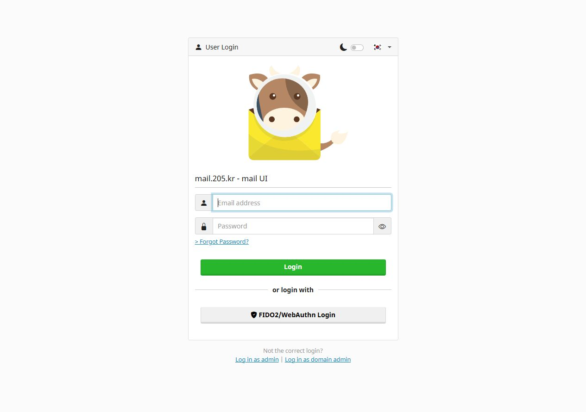

가족과 친구가 개인 도메인의 메일함을 함께 쓰도록 만들었습니다. 쓰던 메일을 새 서버로 옮기고 웹메일과 휴대폰 앱을 연결했습니다. 도메인 비용을 제외한 운영비 0원을 목표로 Oracle Cloud의 무료 자원 범위와 SMTP2GO Free를 조합했습니다.

## 맡은 역할

메일 서비스의 구성과 운영 기준을 정하고, 기존 메일 이관·검증, 신규 계정 안내, 백업·복원 절차를 준비했습니다. 서버 설정과 자동화는 AI 코딩 도구와 함께 구현했습니다. 메일 엔진과 웹메일은 오픈소스 mailcow·SOGo를 사용하고, 필요한 이관·안내 자동화를 프로젝트에 맞게 구성했습니다.

*2026년 10월 7일 촬영한 실제 로그인 화면입니다. mailcow가 제공하는 화면이며, 메일함이나 관리자 내부 화면은 포함하지 않았습니다.*

## 수신과 외부 발신을 나눈 구성

Oracle Cloud의 ARM 서버에 Docker 기반 mailcow를 설치했습니다. 수신·메일 보관·웹메일은 직접 운영하고, 외부 발신은 SMTP2GO로 중계합니다. 메일 앱은 각자의 메일함 계정으로 접속합니다. 공용 중계 비밀번호를 나눠 주지 않아도 됩니다.

| 구성 | 맡는 일 |
|---|---|
| Oracle Cloud · Docker · mailcow | 메일 수신과 보관, 계정·별칭·용량 관리 |
| Postfix · Dovecot · SOGo | SMTP 처리, IMAP 접속, 웹메일 |
| SMTP2GO Free | 외부 수신 서버로 발신 중계 |
| Cloudflare DNS · TLS | 도메인 연결, 발신 인증 레코드, 암호화된 접속 |
| Python · SQLite · systemd | 새 계정 확인과 환영 메일 1회 발송 |
| age | 외부 보관용 백업 암호화 |

수신은 외부 메일 서버에서 mailcow로 들어오며, 외부 발신은 mailcow에서 SMTP2GO를 거쳐 전달됩니다. 웹메일 외에도 IMAP 993과 SMTP 587 STARTTLS를 지원하고, Android Gmail 앱의 실제 계정 등록과 인증을 확인했습니다.

직접 발신도 검토했지만 당시 외부 메일 서버의 25번 포트에 연결되지 않았고 서버 IP의 PTR 레코드도 없었습니다. 기존 중계 경로를 유지하고, 직접 발신은 필요한 조건이 갖춰진 뒤 검토하기로 했습니다.

## 기존 메일을 원본 그대로 옮기기

기존 다음 메일함에서 쓰던 한 메일 주소와 관련된 항목만 골라 이관했습니다. 초기 이관 대상은 4개 폴더의 73개 메일 항목입니다. 본문·첨부파일을 포함한 전체 내용의 SHA-256, 날짜와 읽음 상태를 비교했고 원본이 그대로 유지되는지도 확인했습니다.

새 서버로 전환한 뒤 이전 메일함에 늦게 도착하는 메일은 증분 도구로 옮기도록 준비했습니다. 이전 성공 기록에 없는 항목만 복사하고, 원본의 UIDVALIDITY나 기존 항목에 예상하지 못한 변화가 있으면 중단하도록 했습니다. 최종 증분 도구의 실제 실행은 아직 남아 있습니다.

## 새 계정에 한 번 보내는 환영 메일

계정을 만들면 서버가 1분마다 활성 메일함을 확인해 관리자 인사말과 Android Gmail 안내 PDF를 보냅니다. 받는 사람의 이름과 주소를 본문에 넣고, 임시 비밀번호 변경과 앱 연결 방법을 안내합니다.

SQLite에 주소와 계정 생성 시각을 함께 기록해 중복 발송을 막았습니다. 이름이나 비밀번호 변경만으로는 다시 보내지 않으며, 삭제 후 같은 주소로 새로 만든 계정은 구분합니다. 발송 큐의 수락 여부가 불분명하면 보류합니다. 운영자가 확인하기 전에는 자동으로 다시 보내지 않습니다.

기존 활성 계정 3개에 각각 한 통씩 배달됐고, 이후 자동 실행에서는 추가 발송이 없었습니다. 이 환영 메일은 서버 안에서 내부 배달되므로 외부 중계 서비스로 나가지 않습니다. 실제 휴대폰 화면을 담은 6쪽 PDF와 계정별 안내도 함께 준비했습니다.

## 인증과 백업을 실제로 검증

Gmail과 양방향으로 메일을 주고받았습니다. 수신 원본의 SPF·DKIM·DMARC 결과는 모두 PASS였습니다. 관리자 MFA, TLS 접속, 인증하지 않은 외부 중계 차단도 검증했습니다.

초기 백업은 age로 암호화해 서버 밖에 보관했습니다. 복호화한 메일과 격리된 DB를 확인했으며, 처음 메일을 복원했을 때 해시가 달랐던 원인은 해제하지 않은 압축이었습니다. 암호 해제 후 LZ4 압축까지 풀고 줄끝을 동일하게 맞추자 73개 항목의 전체 내용이 일치했습니다.

| 검증 대상 | 초기 구축 당시 확인한 결과 |
|---|---|
| 이관·설정 도구 | 로컬 테스트 39개 통과 |
| 실제 Dovecot 이관 | 테스트 14개 통과 |
| 환영 메일 자동화 | 로컬·서버에서 테스트 19개씩 통과, 기존 계정 중복 발송 없음 |
| 메일 복원 | 73개 항목의 전체 내용 일치 |
| DB 복원 | 네트워크 격리 환경에서 기동·계정 설정 확인 |

서버가 암호화 키를 관리하므로 운영자는 기술적으로 메일 내용을 확인할 수 있습니다. 이 점과 민감한 자료의 송수신을 피하라는 안내를 환영 메일에 부드럽게 담았습니다.

## 운영하면서 남긴 과제

발신 인증이 모두 통과해도 이후 두 메일이 Gmail 스팸함으로 분류됐습니다. 정상 본문이 있는 메일에서도 발생했고 초기 받은편지함 성공 사례와 같은 발신 IP를 사용했기 때문에, 빈 본문이나 특정 IP 하나를 원인으로 단정하지 않았습니다. 현재 정확한 분류 원인은 미확정입니다.

백업은 초기 메일과 DB 복원을 확인한 단계입니다. 최근 메일과 환영 메일의 발송 이력까지 포함한 후속 백업, 정기 백업, 전체 서비스 재해 복구 연습은 남은 작업으로 기록했습니다. 무료 범위에 맞춘 구성과 실제 청구액 확인도 구분해 관리합니다.

계정을 추가하거나 장애가 생겼을 때 확인할 절차도 정리했습니다. 접속·점검·장애 대응·복구 방법과 검증 날짜를 유지보수 문서에 남겼습니다.
